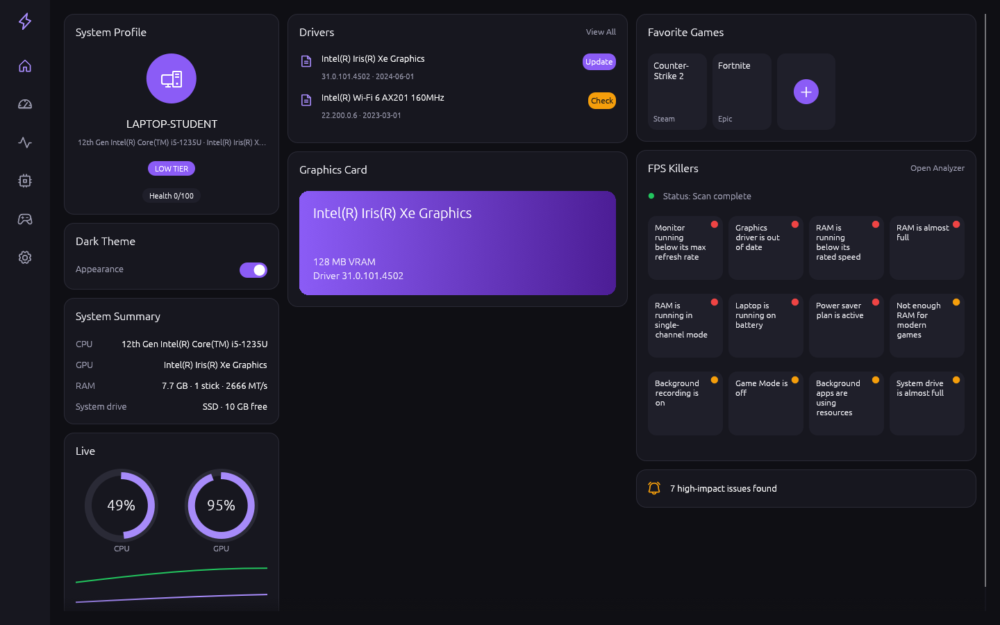
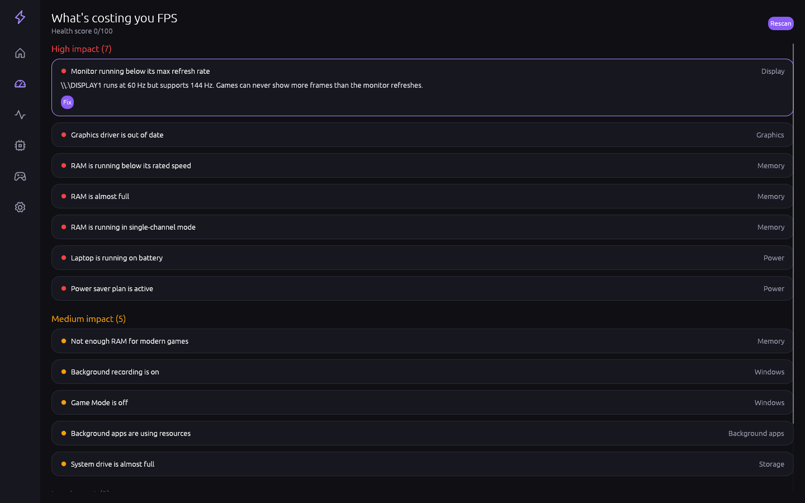
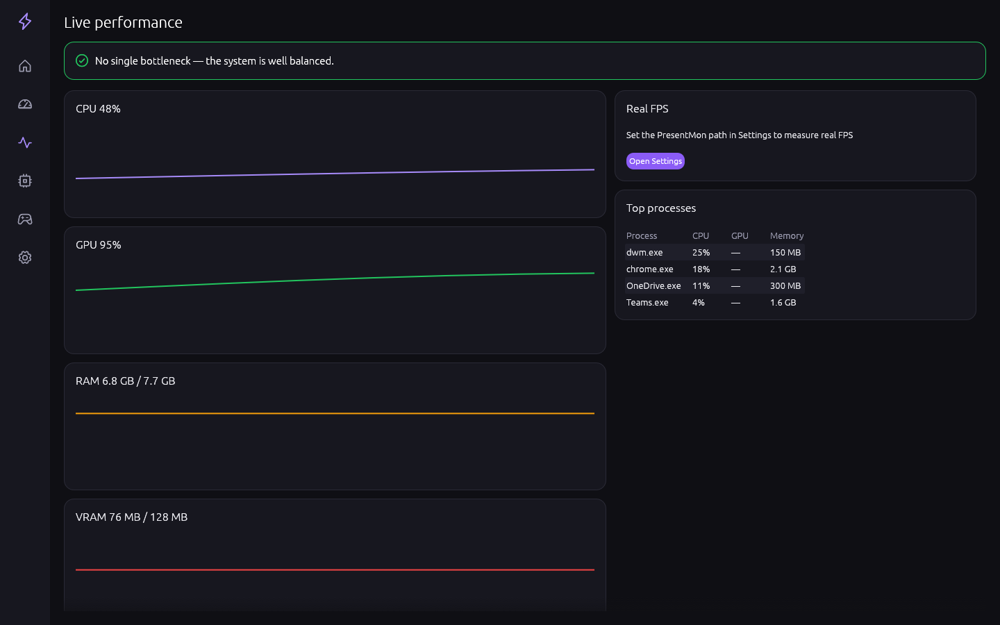

# SpeedImprover

A Windows app, written in Rust, that scans your PC and tells you what is costing you FPS:

- **FPS Killers** — 17 checks (monitor running below its refresh rate, power-saver plan, RAM below its rated speed or in single-channel, Game Mode off, background recording, full disk, apps hogging CPU/RAM, old graphics driver, …), each with a plain-English explanation and a **Fix** button that opens the right Windows Settings page. A 0–100 health score sums them up.
- **Live Monitor** — CPU, GPU, RAM and VRAM load every second, the processes using them, and a verdict on what limits FPS right now (GPU-bound, CPU-bound, VRAM full, thermal throttling, frame-capped). With [PresentMon](https://github.com/GameTechDev/PresentMon/releases) it also measures real FPS and 1 % lows.
- **Drivers** — graphics, chipset, network, audio, storage and Bluetooth drivers, checked against Windows Update, a version catalog and their age.
- **Games** — finds your Steam and Epic games and recommends in-game settings for your hardware and goal (Competitive, Balanced or Quality).

SpeedImprover only **reads** your system. It never changes settings, edits the registry, installs drivers or touches game files — fixes open Windows Settings or the vendor's download page, and you make the change.



| FPS Analyzer | Live Monitor |
|---|---|
|  |  |
| **Drivers** | **Games** |
|  |  |

*(Screenshots show the built-in demo data, not a real PC.)*

## Requirements

- Windows 10 22H2 or later, or Windows 11 (x64).
- No administrator rights needed, except for real-FPS capture with PresentMon.

## Build and run

Install [Rust](https://rustup.rs) (stable), then:

```bash
cargo build --release -p si-app
```

The app is `target/release/speedimprover.exe`.

**Demo mode** (any OS, no real scan) runs the whole UI on saved data:

```bash
cargo run -p si-app -- --fixture crates/si-app/assets/demo.json
```

**Tests:**

```bash
cargo test --workspace
```

Windows-only tests (real WMI, registry and performance counters) run on Windows. Two need a real gaming PC or network and are skipped by default; run them with `cargo test -p si-probe -- --ignored`.

## Measuring real FPS

1. Download `PresentMon` (2.x, the console `.exe`) from its [releases page](https://github.com/GameTechDev/PresentMon/releases).
2. In SpeedImprover open **Settings** and paste the path to the `.exe` into **PresentMon path**.
3. Run SpeedImprover **as administrator** (or add your account to the *Performance Log Users* group).
4. Start your game, open **Live Monitor**, pick the game process and press **Measure FPS**.

## Keeping data up to date

- **Driver versions** — `data/driver_catalog.json`. The app downloads the copy on this repository's `main` branch at startup (10 s timeout) and falls back to the copy built into the app. Update `latest_version` for each vendor when a new driver ships. NVIDIA versions use NVIDIA's format (`621.24`); AMD and Intel use the Windows driver version (`32.0.101.9175`). `min_installed_version` skips drivers on an older branch (e.g. Intel's legacy 6th–10th gen iGPU driver). Only `https://` download links are accepted.
- **Game profiles** — one file per game in `data/games/<id>.toml`:

  ```toml
  id = "cs2"
  name = "Counter-Strike 2"
  steam_appid = 730          # or: epic_app_name = "Fortnite"

  [[settings]]
  label = "Global Shadow Quality"   # exactly as in the game's menu
  impact = "high"                   # FPS cost: low | medium | high
  vram_sensitive = false            # true for texture/model quality
  low = "Low"
  mid = "Medium"
  high = "High"
  ultra = "Very High"
  competitive = "Low"               # optional fixed value for the Competitive goal
  ```

  Add the new file to the list in `crates/si-core/src/games/profile.rs`. A test checks every profile parses and is complete.
- **Hardware tiers** — `data/gpu_tiers.toml` and `data/cpu_tiers.toml` (name patterns per tier).

## Privacy

No telemetry. SpeedImprover contacts only:

- the driver catalog URL (this repository on GitHub, changeable in Settings), with a generic `SpeedImprover/<version>` user agent;
- Windows Update, through Windows' own Update Agent, to list optional driver updates.

Everything else stays on your PC, under `%APPDATA%\SpeedImprover\SpeedImprover\`: `config\settings.toml`, and in `data\` the last scan (`last_scan.json`) and the log (`speedimprover.log`).

## Project layout

| Path | What's there |
|---|---|
| `crates/si-core` | Pure logic: data model, FPS rules, bottleneck classifier, driver status, hardware tiers, game recommendations. Builds and tests on any OS. |
| `crates/si-probe` | Data collection: `sysinfo` everywhere; WMI, registry, DXGI, PDH, NVML, Windows Update and PresentMon on Windows. |
| `crates/si-app` | The eframe/egui app. |
| `data/` | Driver catalog, tier tables, game profiles. |
| `docs/superpowers/` | Design spec and implementation plan. |

## Before a release

Run through this on at least one desktop with a graphics card and one laptop:

- A scan finishes in under 10 seconds, and `speedimprover.log` shows no errors.
- Setting the monitor to 60 Hz shows *Monitor running below its max refresh rate*; setting it back clears it after **Rescan**.
- Turning Game Mode off shows the finding, and **Fix** opens the Game Mode page.
- On battery, a laptop shows *Laptop is running on battery*; a laptop with two GPUs is rated by the discrete one.
- While a game runs, Live Monitor shows GPU % (and temperature on NVIDIA). The verdict changes between GPU-bound (uncapped, max settings) and frame-capped (60 FPS cap).
- With PresentMon set up and running as administrator, **Measure FPS** matches the in-game counter within ±5 %.
- **Check for updates** finishes; **Update** opens the vendor's page.
- The Games page lists Steam and Epic games, and recommendations change with the goal.
- On a non-English Windows install, the CPU performance and GPU readings still appear.

Pushing a tag like `v0.1.0` builds `speedimprover.exe` on GitHub Actions and attaches `SpeedImprover-v0.1.0-x64.zip` to a GitHub release.
