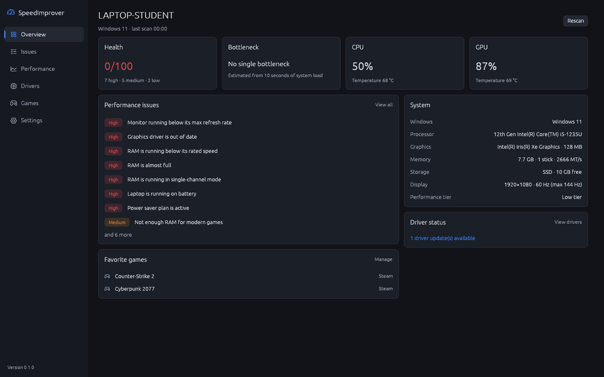
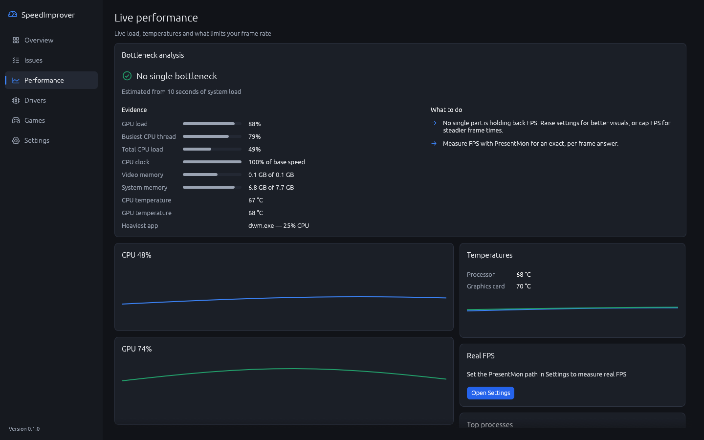
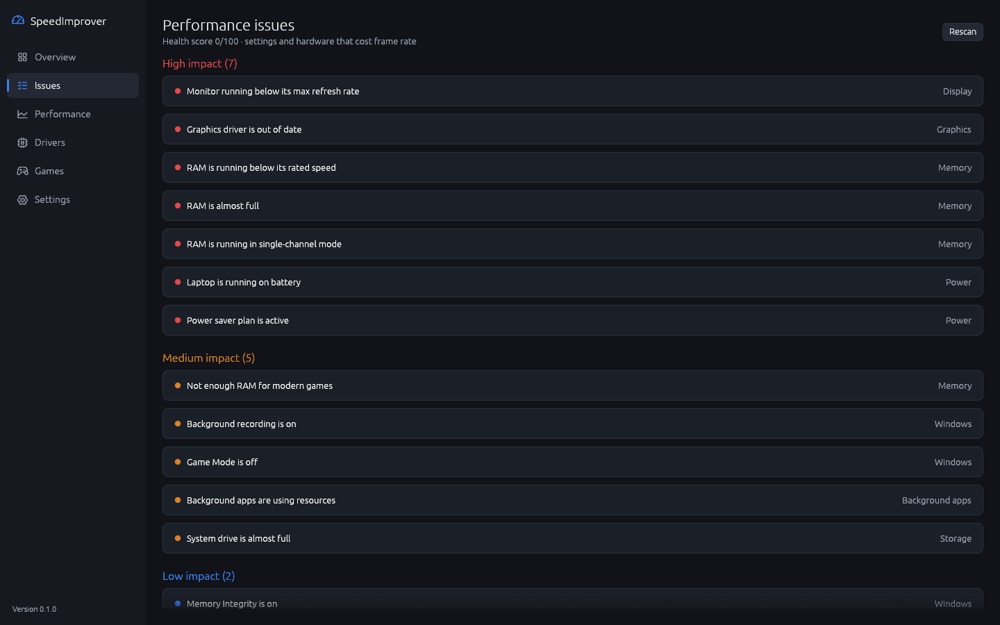
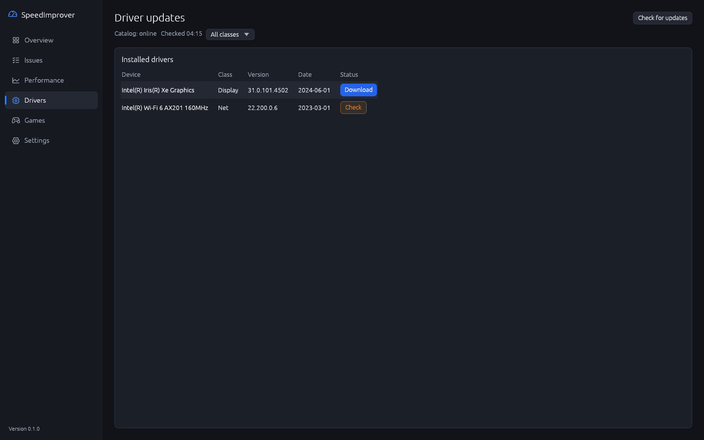
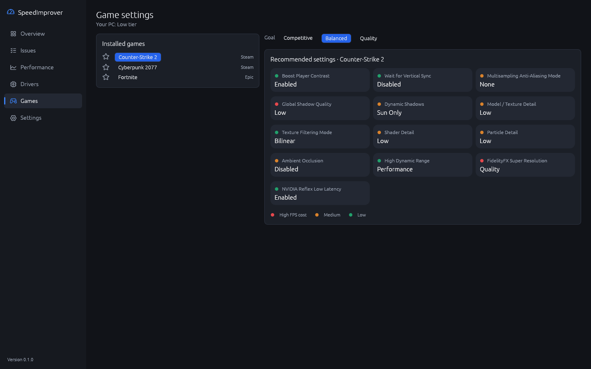
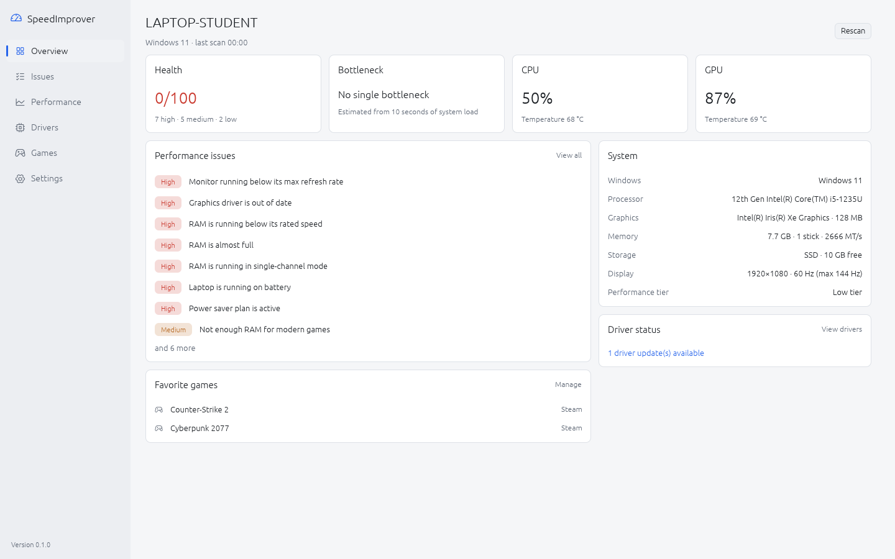

# SpeedImprover

A Windows app, written in Rust, that scans your PC and tells you what is costing you FPS:

- **Overview** — a health score, the current bottleneck, CPU and GPU load with their temperatures, your system's details and the state of your drivers on one page.
- **Issues** — 17 checks (monitor running below its refresh rate, power-saver plan, RAM below its rated speed or in single-channel, Game Mode off, background recording, full disk, apps hogging CPU/RAM, old graphics driver, …), each with a plain-English explanation and a **Fix** button that opens the right Windows Settings page. A 0–100 health score sums them up.
- **Performance** — exactly what is limiting your frame rate (GPU, CPU, video memory, system memory, thermal throttling or the refresh-rate cap), the measurements that prove it and what to do about it. CPU, GPU, RAM and VRAM load every second, CPU and GPU temperatures, and the processes using them. With [PresentMon](https://github.com/GameTechDev/PresentMon/releases) it also measures real FPS and 1 % lows, and the bottleneck is measured frame by frame.
- **Drivers** — graphics, chipset, network, audio, storage and Bluetooth drivers, checked against Windows Update, a version catalog and their age. Updates offered by Windows Update install with one click (after a System Restore point).
- **Games** — finds your Steam and Epic games and recommends in-game settings for your hardware and goal (Competitive, Balanced or Quality).

SpeedImprover changes nothing on its own. Settings fixes open the right Windows Settings page and you make the change. The one thing it can change is drivers, and only when you click **Install** and approve Windows' administrator prompt — see [Installing driver updates](#installing-driver-updates). It never edits the registry or touches game files.

The interface follows Windows' light or dark mode (change it under **Settings → Theme**).



| Performance | Issues |
|---|---|
|  |  |
| **Drivers** | **Games** |
|  |  |



*(Screenshots show the built-in demo data, not a real PC.)*

## Requirements

- Windows 10 22H2 or later, or Windows 11 (64-bit).
- No administrator rights needed to run it. Windows asks for administrator permission only when you install a driver update, and real-FPS capture with PresentMon needs it too.
- Optional: [LibreHardwareMonitor](https://github.com/LibreHardwareMonitor/LibreHardwareMonitor/releases) for exact CPU temperatures (see [Temperatures](#temperatures)).
- No installer and no background service: it is a single `.exe`.

## Download and run

1. Open the [Releases page](https://github.com/supernover80/Speedimprover/releases) and, under the newest release, download **`SpeedImprover-vX.Y.Z-x64.zip`**.
2. Right-click the zip and choose **Extract All…**, then pick a folder to keep it in (for example `Documents\SpeedImprover`).
3. Open that folder and double-click **`speedimprover.exe`**.
4. The first time, Windows may show **"Windows protected your PC"** (SmartScreen), because the app is not code-signed. Click **More info**, then **Run anyway**.
5. The app opens on the **Overview** and starts scanning straight away. The scan takes a few seconds; the driver check (Windows Update) can take up to a minute and finishes in the background.

Tips:

- **Pin it:** right-click `speedimprover.exe` → **Pin to Start**, or create a desktop shortcut.
- **Real FPS** needs administrator rights: right-click `speedimprover.exe` → **Run as administrator** (see [Measuring real FPS](#measuring-real-fps)).
- **Update:** download the newer zip and replace `speedimprover.exe`. Your settings are kept.
- **Uninstall:** delete the folder you extracted, and `%APPDATA%\SpeedImprover` if you also want to remove settings and the log.

No release yet, or want the latest code? Run it from source instead.

## Run from source

On the Windows PC:

1. Install the [Visual Studio C++ Build Tools](https://visualstudio.microsoft.com/visual-cpp-build-tools/) (choose **Desktop development with C++**) — Rust needs its linker.
2. Install [Rust](https://rustup.rs) with the default options.
3. Install [Git](https://git-scm.com/download/win), then in a terminal:

```bash
git clone https://github.com/supernover80/Speedimprover.git
```

```bash
cd Speedimprover
```

4. Build and start the app (the first build takes a few minutes):

```bash
cargo run --release -p si-app
```

The built program is `target\release\speedimprover.exe`; you can copy it anywhere and run it on its own. To only build it:

```bash
cargo build --release -p si-app
```

**Demo mode** (any OS, no real scan) runs the whole UI on saved data:

```bash
cargo run -p si-app -- --fixture crates/si-app/assets/demo.json
```

**Tests:**

```bash
cargo test --workspace
```

Windows-only tests (real WMI, registry and performance counters) run on Windows. Two need a real gaming PC or network and are skipped by default; run them with `cargo test -p si-probe -- --ignored`.

## What is limiting your FPS

Open **Performance**. The **Bottleneck analysis** card gives one verdict — for example *The GPU is the bottleneck* — then the evidence behind it (each measurement with a bar; the ones that decided the verdict are highlighted) and what to do about it. The line under the verdict says how it was worked out:

- **Measured from N frames** — while PresentMon is measuring a game (see below). For every frame PresentMon reports how long the CPU and the GPU were busy. Whichever was busy for at least 90 % of the frame time is the limit. If the frame rate sits on your monitor's refresh rate, the cap is the limit instead.
- **Estimated from N seconds of system load** — otherwise. The verdict comes from the last ten seconds of GPU load, the busiest CPU thread, CPU clock speed, memory use and temperatures. Start a PresentMon measurement for an exact, per-frame answer.

Either way, full video or system memory, thermal throttling and a CPU running well below its base clock are reported first, because they are the root cause when present.

## Measuring real FPS

1. Download `PresentMon` (2.x, the console `.exe`) from its [releases page](https://github.com/GameTechDev/PresentMon/releases).
2. In SpeedImprover open **Settings** and paste the path to the `.exe` into **PresentMon path**.
3. Run SpeedImprover **as administrator** (or add your account to the *Performance Log Users* group).
4. Start your game, open **Performance**, pick the game process under **Real FPS** and press **Measure FPS**. The bottleneck analysis switches to per-frame measurement after about 30 frames.

## Temperatures

The Overview and Performance pages show the CPU and GPU temperature, updated every second.

- **GPU** — read from the NVIDIA driver on NVIDIA cards, otherwise from LibreHardwareMonitor if it is running, otherwise from the graphics driver itself (most current AMD and Intel drivers report it).
- **CPU** — Windows has no standard way to read the CPU's own sensor. For an exact reading, run **LibreHardwareMonitor** in the background:
  1. Download it from its [releases page](https://github.com/LibreHardwareMonitor/LibreHardwareMonitor/releases), extract it and run `LibreHardwareMonitor.exe` **as administrator**.
  2. Leave it running (its **Options** menu can start it minimized with Windows). SpeedImprover picks up its sensors within 30 seconds. OpenHardwareMonitor works too.

  Without it, SpeedImprover uses the motherboard's ACPI thermal zone and shows the value as **(approx.)**: it is often a motherboard sensor rather than the CPU cores, and some PCs do not report one at all (shown as **—**).

## Installing driver updates

On **Drivers**, each driver's button shows what is available:

- **Install** — Windows Update offers a newer driver. Click it, or **Install all (N)** at the top (also on the Overview), to install it from inside SpeedImprover.
- **Download** — the vendor has a newer driver that Windows Update does not offer yet. It opens the vendor's download page.
- **Check** — the driver is over a year old but no update was found. It opens Windows Update's *Optional updates* page.

What happens when you install:

1. SpeedImprover lists what it will install and asks you to confirm.
2. Windows asks for administrator permission (the usual blue/yellow prompt). Choosing **No** cancels; nothing is changed.
3. A **System Restore point** is created first, so you can roll back from *Control Panel → Recovery → Open System Restore* if a driver causes problems. If System Protection is turned off for drive C:, Windows cannot create one; the install still runs and SpeedImprover tells you.
4. Windows Update downloads and installs the drivers — the same packages Windows would install itself. SpeedImprover then checks your drivers again.
5. If a driver needs a restart, a banner asks you to restart your PC.

Only drivers from Windows Update are installed. SpeedImprover never downloads installers from other websites.

## Keeping data up to date

- **Driver versions** — `data/driver_catalog.json`. The app downloads the copy on this repository's `main` branch at startup (10 s timeout) and falls back to the copy built into the app. Update `latest_version` for each vendor when a new driver ships. NVIDIA versions use NVIDIA's format (`621.24`); AMD and Intel use the Windows driver version (`32.0.101.9175`). `min_installed_version` skips drivers on an older branch (e.g. Intel's legacy 6th–10th gen iGPU driver). Only `https://` download links are accepted.
- **Game profiles** — one file per game in `data/games/<id>.toml`:

  ```toml
  id = "cs2"
  name = "Counter-Strike 2"
  steam_appid = 730          # or: epic_app_name = "Fortnite"

  [[settings]]
  label = "Global Shadow Quality"   # exactly as in the game's menu
  impact = "high"                   # FPS cost: low | medium | high
  vram_sensitive = false            # true for texture/model quality
  low = "Low"
  mid = "Medium"
  high = "High"
  ultra = "Very High"
  competitive = "Low"               # optional fixed value for the Competitive goal
  ```

  Add the new file to the list in `crates/si-core/src/games/profile.rs`. A test checks every profile parses and is complete.
- **Hardware tiers** — `data/gpu_tiers.toml` and `data/cpu_tiers.toml` (name patterns per tier).

## Privacy

No telemetry. SpeedImprover contacts only:

- the driver catalog URL (this repository on GitHub, changeable in Settings), with a generic `SpeedImprover/<version>` user agent;
- Windows Update, through Windows' own Update Agent, to list optional driver updates and — when you click **Install** — to download and install them.

Everything else stays on your PC, under `%APPDATA%\SpeedImprover\SpeedImprover\`: `config\settings.toml`, and in `data\` the last scan (`last_scan.json`) and the log (`speedimprover.log`).

## Project layout

| Path | What's there |
|---|---|
| `crates/si-core` | Pure logic: data model, FPS rules, bottleneck analysis, frame-time parsing, driver status, hardware tiers, game recommendations. Builds and tests on any OS. |
| `crates/si-probe` | Data collection: `sysinfo` everywhere; WMI, registry, DXGI, PDH, NVML, D3DKMT and LibreHardwareMonitor (temperatures), Windows Update (search and install), System Restore and PresentMon on Windows. |
| `crates/si-app` | The eframe/egui app. |
| `data/` | Driver catalog, tier tables, game profiles. |
| `docs/superpowers/` | Design spec and implementation plan. |

## Before a release

Run through this on at least one desktop with a graphics card and one laptop:

- A scan finishes in under 10 seconds, and `speedimprover.log` shows no errors.
- Setting the monitor to 60 Hz shows *Monitor running below its max refresh rate*; setting it back clears it after **Rescan**.
- Turning Game Mode off shows the finding, and **Fix** opens the Game Mode page.
- On battery, a laptop shows *Laptop is running on battery*; a laptop with two GPUs is rated by the discrete one.
- While a game runs, Performance shows GPU % and the GPU temperature. The verdict changes between *The GPU is the bottleneck* (uncapped, max settings) and the refresh-rate cap (FPS capped at the monitor's rate).
- The CPU temperature shows **(approx.)** or **—** without LibreHardwareMonitor, and an exact value within 30 seconds of starting it.
- With PresentMon set up and running as administrator, **Measure FPS** matches the in-game counter within ±5 %, and the analysis says *Measured from N frames*.
- **Check for updates** finishes; **Download** opens the vendor's page.
- On a PC with a Windows Update driver offer: **Install** shows the confirmation, the administrator prompt, then installs; a restore point appears in System Restore, the driver list refreshes and the restart banner appears when needed. Choosing **No** at the administrator prompt shows *Installation cancelled*.
- Light and dark mode follow Windows when the theme is **System**.
- The Games page lists Steam and Epic games, and recommendations change with the goal.
- On a non-English Windows install, the CPU performance and GPU readings still appear.

## Publishing a release

The download on the Releases page is built by GitHub Actions. To publish a new version, push a version tag:

```bash
git tag v0.1.0
```

```bash
git push origin v0.1.0
```

The **Release** workflow then builds `speedimprover.exe` on Windows and attaches `SpeedImprover-v0.1.0-x64.zip` (the program plus this README) to a new GitHub release.
